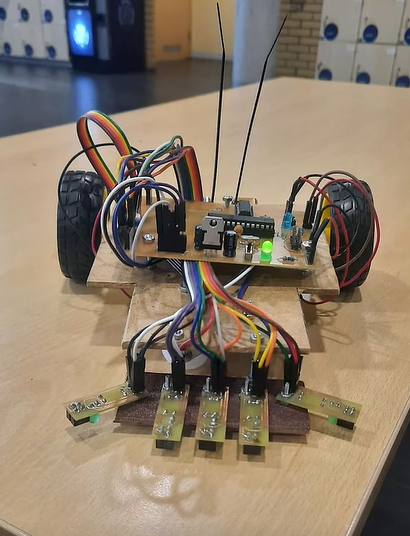
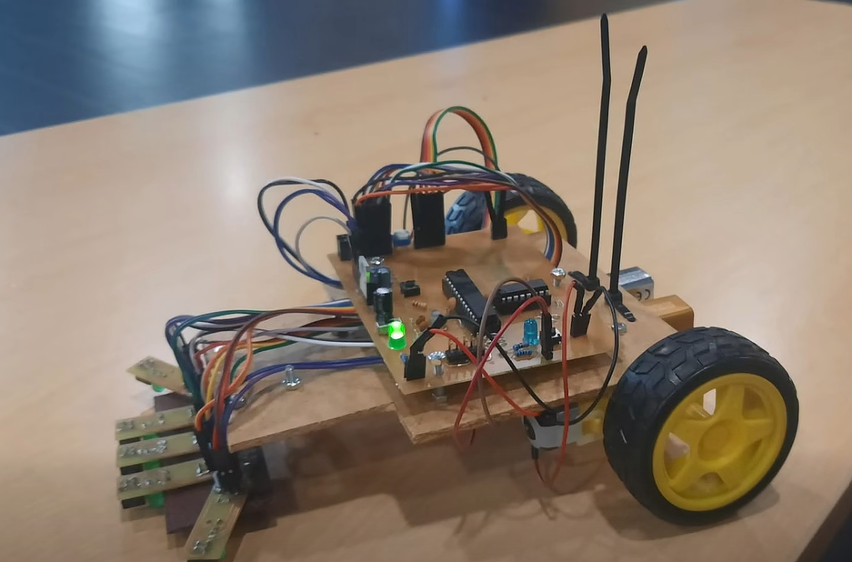
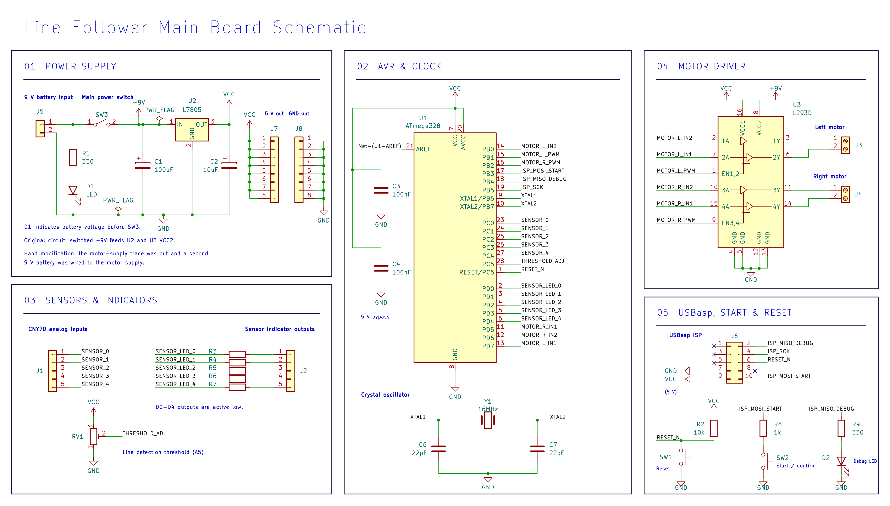
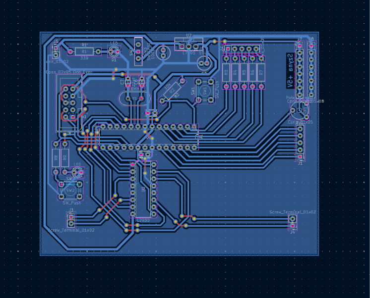
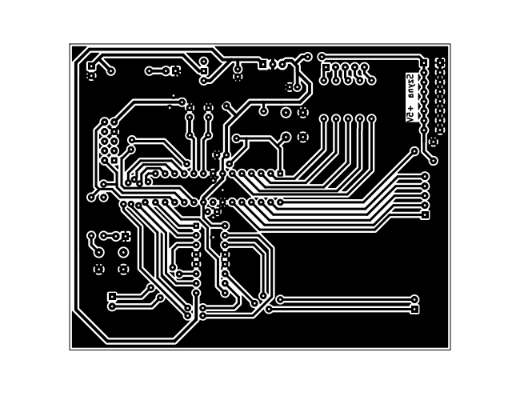
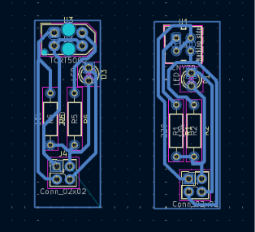
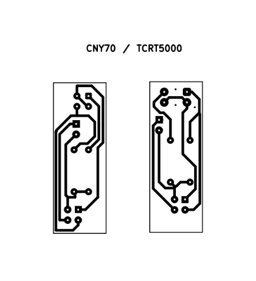

# Line Follower

A competition robot with a hand-etched PCB, five reflective sensors and PD steering.

**3rd place in the "Fastest Line Follower" category at Roboday 2026, Poznan University of Technology (May 15, 2026)**

*Front view of the competition robot.*

## About

I designed the electronics in KiCad, etched and assembled the boards, and wrote the firmware in Arduino IDE. An ATmega8 reads the sensors and drives the two wheels independently through an L293D motor driver.

*Side view of the assembled robot.*

## Features

- Five CNY70 reflective sensors on the front of the chassis.
- A potentiometer for setting the detection threshold before a run.
- A start button and a short countdown.
- Separate battery supplies for the control electronics and the motors.

## How It Works

1. **Detect the line.** The five sensors measure reflected light. Their readings are used to estimate the line's position relative to the centre of the robot.
2. **Calculate a correction.** The PD controller uses that position error and how much it has changed since the previous reading.
3. **Steer.** The firmware adjusts the PWM and direction of each motor to bring the robot back towards the line.

## PCB

### Main Board

*Main board schematic in KiCad, before the motor supply modification.*

*Main board PCB design in KiCad.*

*Main board copper pattern for etching.*

### IR Sensor Boards

*IR sensor board PCB design in KiCad.*

*IR sensor board copper pattern for etching.*

I etched the boards in a single run. The robot used CNY70 modules, and I made TCRT5000 boards as spares. Feeding the sensors from the same rails helped avoid false readings where a sensor would appear to see the line all the time or miss it entirely.

### Power supply fix

A single 9 V battery initially supplied the electronics and the motors. The robot would move briefly and then shut down under motor load. I scraped away a short section of the trace feeding the motor supply and drilled two holes for the new power leads. A second 9 V battery powered the motors, while the original battery powered the electronics.

## Firmware

The [latest firmware for this line follower](software/linefollower/linefollower.ino) includes PD steering, an adjustable sensor threshold and a start countdown. The first button press confirms the threshold, and the next starts the countdown.

I programmed the ATmega8 with a USBasp programmer through the board’s 2 × 5 ISP header (J6).

## Hardware

| Component | Qty |
| --- | :---: |
| ATmega8 microcontroller (U1) + 16 MHz crystal (Y1) | 1 set |
| L293D dual H-bridge motor driver (U3) | 1 |
| L7805 5 V regulator (U2) | 1 |
| CNY70 reflective sensor module | 5 |
| 5 V DC motor | 2 |
| 9 V battery, one for each supply | 2 |
| Trimmer potentiometer (RV1) | 1 |
| 3 mm battery power indicator LED (D1) | 1 |
| 3 mm firmware-controlled debug LED (D2) | 1 |
| Start and threshold confirmation push button (SW2) | 1 |
| Reset push button (SW1) | 1 |
| Slide power switch (SW3) | 1 |
| 2 × 5 ISP header (J6) | 1 |
| 1 × 5 headers for sensor inputs and indicator outputs (J1, J2) | 2 |
| 1 × 2 headers for the motor outputs and battery input (J3–J5) | 3 |
| 1 × 8 headers for the 5 V and ground rails (J7, J8) | 2 |
| Capacitors (C1–C4, C6, C7) | 6 |
| Fixed resistors (R1–R9) | 9 |
| Custom hand-etched main PCB | 1 |

The capacitor values are 100 µF, 10 µF, two 100 nF and two 22 pF. R1 and R9 are 330 Ω, R2 is the 10 kΩ reset pull-up, and R8 is the 1 kΩ resistor in series with SW2. The five sensor indicator resistors (R3–R7) are labelled `R` in the schematic.

## Competition

After tuning the PD controller, I got the course time down to about **39 seconds**, which put me in **second place** at that stage.

In a high-speed trial, I overvolted the **5 V motors to 18 V** and completed the course in about **20 seconds**, roughly **two seconds faster** than the winning time.

Steering was unstable at that speed. The final required three completed runs. The robot finished its first run and went off the line on the second, which invalidated the attempt. I finished **third overall**.

## Author

Patryk Czupak
